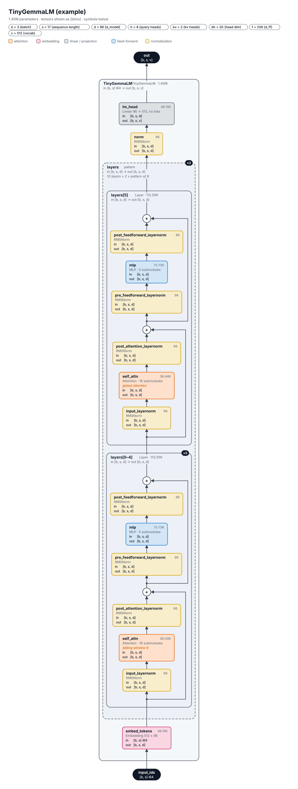
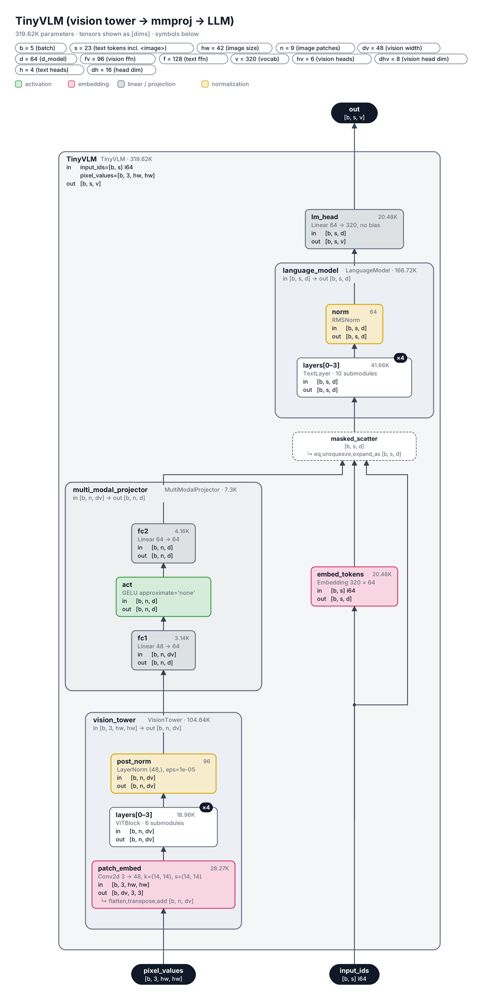
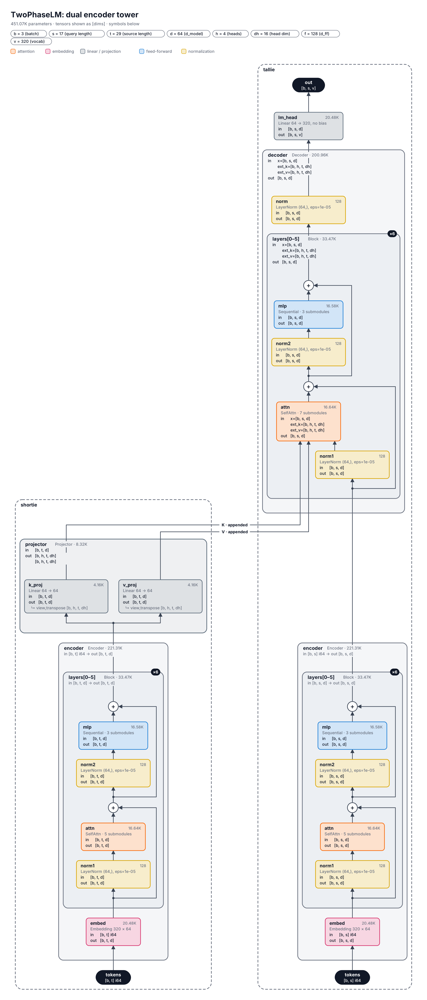

# archsheet

Blueprint-style **architecture sheets** of PyTorch models: every submodule, nested, with symbolic
tensor shapes (`[b, s, h·dh]`), real dataflow (residuals, gates, fan-out, skip connections), repeated
layers collapsed to `×N`, and multi-entry-point models drawn as dashed phase regions.

The model is traced on the `meta` device, so nothing is allocated or computed: a 70B model draws in
seconds. Output is SVG, a pan/zoom HTML page (hover for exact numeric shapes) and optionally PNG.

| | | |
|:--:|:--:|:--:|
| <a href="examples/output/gemma_like_overview.png"></a> | <a href="examples/output/vlm_overview.png"></a> | <a href="examples/output/two_phase_overview.png"></a> |
| **Gemma-style LM**<br>GQA, QK-norm, RoPE, sandwich norms, 5 local : 1 global | **Vision-language model**<br>vision tower → projector merged into the text embeddings | **Two-phase model**<br>two entry points sharing K/V |

Click a picture for the full-size PNG; every example also has a `*_detail` view (`--depth 4`) and
`.svg` / `.html` versions in [`examples/output/`](examples/output). See [`examples/`](examples) for the
specs behind them.

## Quick start

```bash
pip install torch cairosvg        # cairosvg is only needed for --png
pip install -e .                  # optional: gives you an `archsheet` command

python -m archsheet examples/vlm_spec.py -o out/vlm --png
```

A spec is a small Python file with a `build()` function that returns the model, example inputs and the
names of the dimensions worth showing:

```python
import torch
from my_project.model import MyModel, MyConfig

def build():
    return dict(
        model=MyModel(MyConfig()),
        inputs={"input_ids": torch.zeros(3, 17, dtype=torch.long)},
        symbols={"b": (3, "batch"), "s": (17, "sequence"), "d": (96, "d_model")},
    )
```

Copy [`templates/spec_template.py`](templates/spec_template.py) for the full list of options. Dimension
values must be unique (`b=3` and `kv=3` would be indistinguishable) and dynamic dims must not collide
with config dims; odd or prime values such as `b=3, s=17` work well.

Useful flags (all of them are listed in [`SKILL.md`](SKILL.md)):

| flag | meaning |
|---|---|
| `--depth N` | how many module levels to expand (`2` = block overview, default `4`) |
| `--ops none\|merge\|key\|all` | which functional ops are drawn as nodes |
| `--theme light\|blueprint` | white diagram, or a dark-blue engineering-drawing style |
| `--no-collapse` | draw every repeated layer instead of `×N` |
| `--hide-skips` | leave out residual skip lines; everything else stays exactly where it was |

The program prints a text outline of every shape and a one-line **layout check** (edges, branch points,
crossings, short jogs) so a dense view can be spotted without eyeballing it.

## Reading a sheet

Data flows bottom → top. Rounded boxes are modules (coloured by kind), tinted boxes are containers,
dashed cards are functional ops (SDPA, `cat`, `masked_scatter` ...), circles are `+` / `×`.

- A filled dot marks a place where one tensor really splits. Two different tensors that merely cross
  have no dot, and the crossed line is interrupted by a small gap.
- Lines are continuous across container borders: a tensor leaves a container exactly where the inner
  line ends.
- Residual skips run in a lane right next to the content and enter `+` from the side; with or without
  them the rest of the layout does not move.

## As a Claude Code skill

This repository is also a skill: [`SKILL.md`](SKILL.md) tells Claude how to find the model, write the
spec, run the tool and read the result.

```bash
git clone https://github.com/KetanBasi/archsheet ~/.claude/skills/archsheet
pip install torch            # required
pip install cairosvg         # optional, only for --png
```

## Layout

```
archsheet/
├─ SKILL.md              skill description and the layout rules
├─ archsheet/            the package: cli, trace, graph, layout, render
├─ templates/            spec_template.py
└─ examples/             specs + rendered output
```

Requires Python ≥ 3.9 and `torch ≥ 2.1`.
