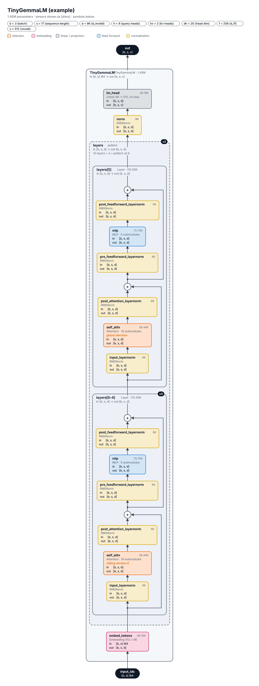
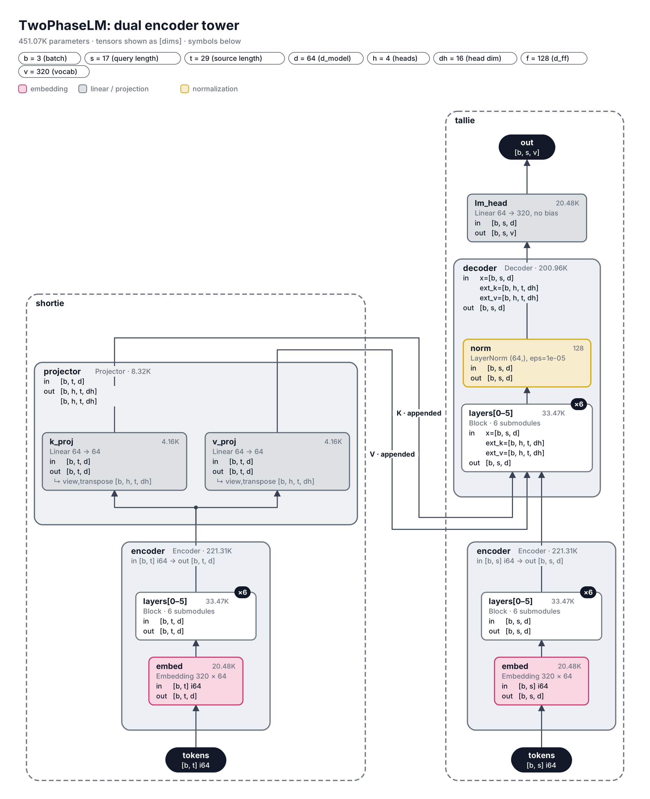
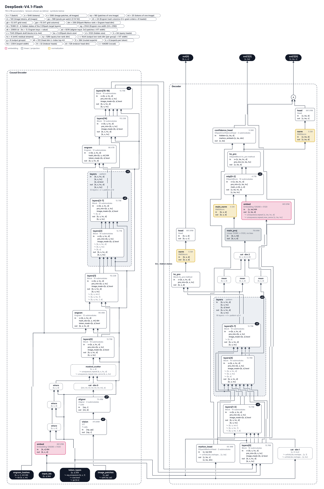
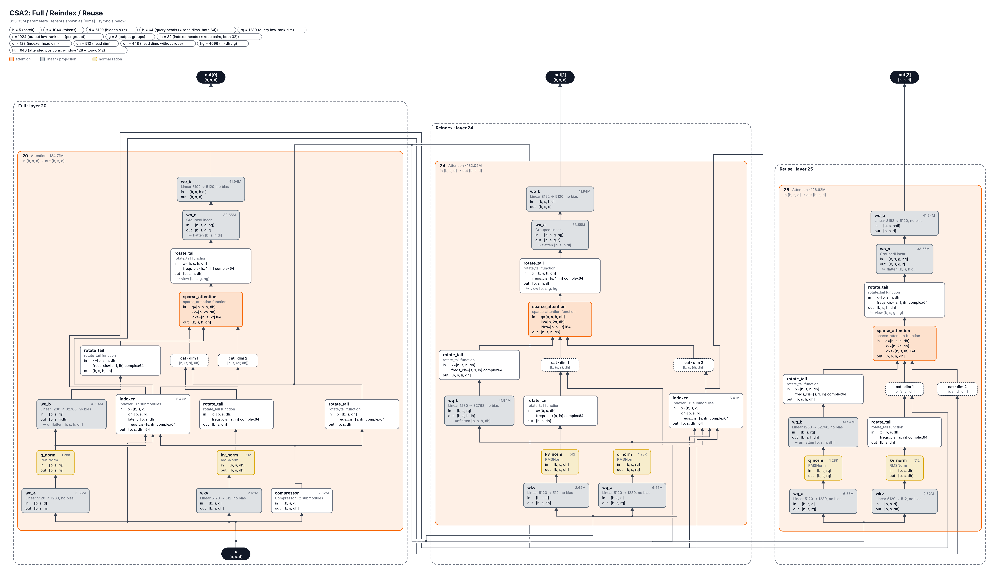

# Examples

Five specs, rendered into [`output/`](output). The first three have an overview (`--depth 2`) and a detail
view (`--depth 4`); the two DeepSeek specs have one sheet each. Regenerate everything from the repository root with:

```bash
for n in gemma_like vlm two_phase; do
  python -m archsheet examples/${n}_spec.py -o examples/output/${n}_overview --depth 2 --png
  python -m archsheet examples/${n}_spec.py -o examples/output/${n}_detail   --depth 4 --png
done
python -m archsheet examples/deepseek_v41_flash_spec.py -o examples/output/deepseek_overview --depth 1 --png
python -m archsheet examples/deepseek_csa2_modes_spec.py -o examples/output/deepseek_csa2_modes --png
```

## `gemma_like_spec.py` — Gemma-style language model

Grouped-query attention, QK-norm, rotary embeddings, sandwich norms and a 5 local : 1 global layer
pattern (`12 layers = 2 × pattern of 6`); the two layer variants differ only in `sliding window 8` vs
`global attention`, which is written on the node that owns it.

<a href="output/gemma_like_overview.png"></a>

[detail PNG](output/gemma_like_detail.png) · [detail HTML](output/gemma_like_detail.html) ·
[detail SVG](output/gemma_like_detail.svg) · [overview HTML](output/gemma_like_overview.html)

## `vlm_spec.py` — vision tower → projector → language model

The image branch is merged into the text branch at the input-embedding level
(`inputs_embeds.masked_scatter(mask, image_features)`). The forward opens two `phase(...)` blocks, `Vision` and
`Language`, side by side: the projector output at the top of the vision tower runs down the channel between
them to the merge point, so there is no long line from `input_ids` across the sheet.

<a href="output/vlm_overview.png"></a>

[detail PNG](output/vlm_detail.png) · [detail HTML](output/vlm_detail.html) ·
[detail SVG](output/vlm_detail.svg) · [overview HTML](output/vlm_overview.html)

## `two_phase_spec.py` — two entry points sharing state

`shortie` encodes source tokens and stores K/V in a projector; `tallie` runs the encoder and decoder,
and the stored K/V are appended to every decoder attention. It uses the two helpers a spec can import
from the package, `phase("name")` for the dashed regions and `label(tensor, "text")` to name a flow:

```python
from archsheet import label, phase
```

<a href="output/two_phase_overview.png"></a>

[detail PNG](output/two_phase_detail.png) · [detail HTML](output/two_phase_detail.html) ·
[detail SVG](output/two_phase_detail.svg) · [overview HTML](output/two_phase_overview.html)

## `deepseek_v41_flash_spec.py` — DeepSeek-V4.1-Flash, overall architecture

Reproduces figure 3 of the [DeepSeek-V4.1-Flash paper](https://arxiv.org/abs/2609.19969): a 20-layer
causal encoder and a 20-layer decoder side by side (two `phase(...)` regions), Engram memory feeding the
encoder, the vision tower merged into the token embeddings, `×N` patterns of layer variants
(encoder: 2 SWA layers, `Full + 5 × Reuse` twice, then the Engram layer 14 and the rest; decoder:
`Full`, 3 × `Reuse`, then 4 × `Reindex + 3 × Reuse`), `Enc. hidden states` flowing into the decoder's
first layer, and the DSpark draft head on top.

<a href="output/deepseek_overview.png"></a>

[overview HTML](output/deepseek_overview.html) · [overview SVG](output/deepseek_overview.svg)

The model is **not a stand-in**: [`deepseek_v41_flash/`](deepseek_v41_flash) is the released
`inference/model.py` adapted for training (MIT, see its `LICENSE`; the table at the top of `model.py` lists
every change: no caches or `start_pos`, plain torch instead of the fp8/fp4 and TileLang kernels, stacked
experts with `F.grouped_mm` instead of `.tolist()`, teacher-forced DSpark, one `masked_scatter` for the
image merge). It runs forward and backward, and at the released shapes it builds on the `meta` device
(763 B parameters). The spec only picks what to draw: two `phase(...)` blocks in a subclass's `forward`, and

```python
FLAGS = dict(trace_methods="Block.hc_mixes,Block.hc_pre,Block.hc_post,deepseek_v41_flash.model:sparse_attention")
```

so that the hyper-connection helpers (plain methods) and the sparse-attention function (a plain function)
get their own boxes without touching the model. The sheet is `--depth 1`: blocks closed. `--depth 2` opens
every block (about 800 edges, a 16000 px tall PNG) and is meant for zooming in the SVG / HTML.

Differences from the figure, on purpose:

- Layers 1 and 14 carry an Engram gate, so they are drawn as their own boxes instead of being folded into
  the `×N` patterns (the figure leaves that out).
- The token-modality mask and the Engram n-gram hashes are model inputs here, so they are lines on the sheet.
- Indexer parameters get no gradient from the language-model loss (top-k selection is not differentiable);
  training them needs the separate indexer loss, which is not part of this model.

## `deepseek_csa2_modes_spec.py` — CSA2 Full / Reindex / Reuse

Reproduces figure 4 of the same paper from the real `Attention` modules of layers 20 (Full), 24 (Reindex)
and 25 (Reuse): the Full layer has a `compressor` and an `indexer`, Reindex only an `indexer`, Reuse neither,
and the lines leaving one region and entering a later one are the shared Main KV, Indexer K and Top-K
indices. `rotate_tail` and `sparse_attention` are drawn as boxes with `trace_methods`.

<a href="output/deepseek_csa2_modes.png"></a>

[HTML](output/deepseek_csa2_modes.html) · [SVG](output/deepseek_csa2_modes.svg)

Not reproduced: the paper's figure 5 (hierarchical sparse indexer) is an illustration of selected
positions and blocks, not a dataflow graph.
