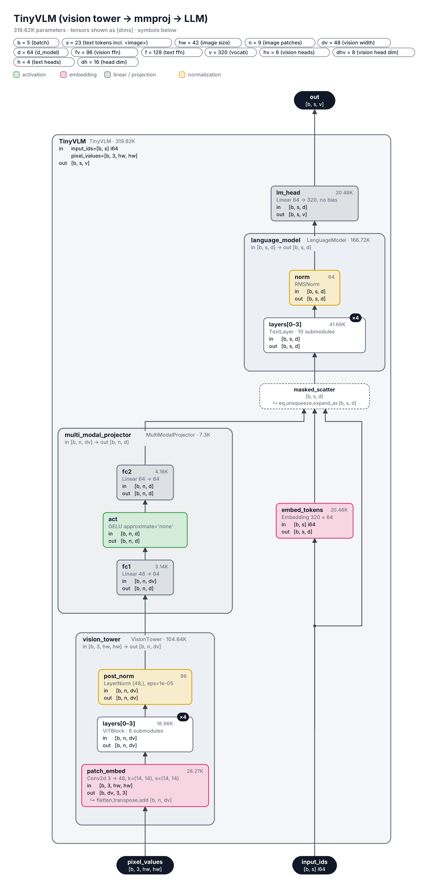

# Examples

Three specs, each rendered as an overview (`--depth 2`) and a detail view (`--depth 4`) into
[`output/`](output). Regenerate them from the repository root with:

```bash
for n in gemma_like vlm two_phase; do
  python -m archsheet examples/${n}_spec.py -o examples/output/${n}_overview --depth 2 --png
  python -m archsheet examples/${n}_spec.py -o examples/output/${n}_detail   --depth 4 --png
done
```

## `gemma_like_spec.py` — Gemma-style language model

Grouped-query attention, QK-norm, rotary embeddings, sandwich norms and a 5 local : 1 global layer
pattern (`12 layers = 2 × pattern of 6`); the two layer variants differ only in `sliding window 8` vs
`global attention`, which is written on the node that owns it.

<a href="output/gemma_like_overview.png"></a>

[detail PNG](output/gemma_like_detail.png) · [detail HTML](output/gemma_like_detail.html) ·
[detail SVG](output/gemma_like_detail.svg) · [overview HTML](output/gemma_like_overview.html)

## `vlm_spec.py` — vision tower → projector → language model

The image branch is merged into the text branch at the input-embedding level
(`inputs_embeds.masked_scatter(mask, image_features)`). The text path stays one straight column, the
vision branch comes in from the left, and the `<image>` mask path runs up the right.

<a href="output/vlm_overview.png"></a>

[detail PNG](output/vlm_detail.png) · [detail HTML](output/vlm_detail.html) ·
[detail SVG](output/vlm_detail.svg) · [overview HTML](output/vlm_overview.html)

## `two_phase_spec.py` — two entry points sharing state

`shortie` encodes source tokens and stores K/V in a projector; `tallie` runs the encoder and decoder,
and the stored K/V are appended to every decoder attention. It uses the two helpers a spec can import
from the package, `phase("name")` for the dashed regions and `label(tensor, "text")` to name a flow:

```python
from archsheet import label, phase
```

<a href="output/two_phase_overview.png"></a>

[detail PNG](output/two_phase_detail.png) · [detail HTML](output/two_phase_detail.html) ·
[detail SVG](output/two_phase_detail.svg) · [overview HTML](output/two_phase_overview.html)
